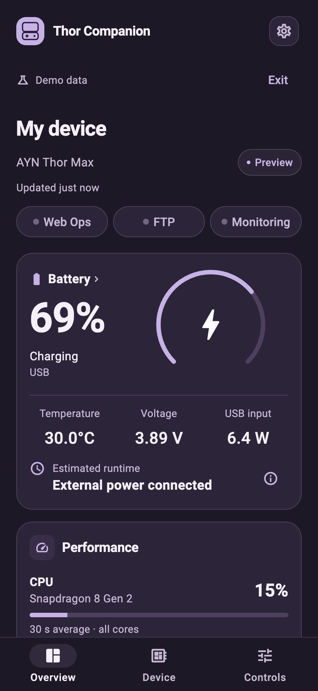
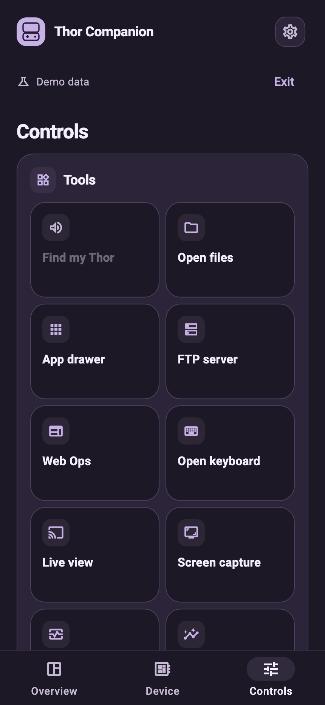
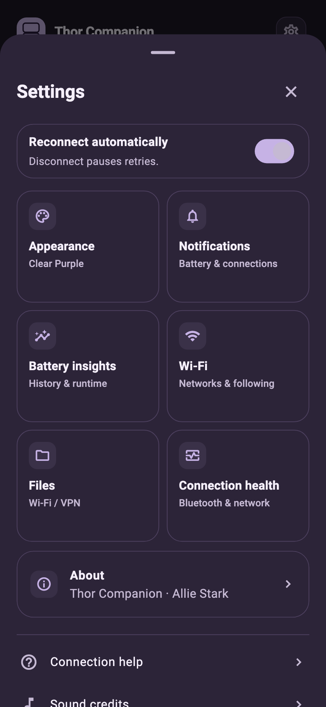

Monitor and control your Android handheld (AYN Thor, Retroid Pocket Classic and others) from an iPhone or Android phone, or from a browser with Web Ops.

[Downloads](https://github.com/Allie9Lives/thor-companion/releases/latest) · [Setup](docs/setup.md) · [Report a bug](https://github.com/Allie9Lives/thor-companion/issues)

## Download 0.18.0 — CORE multi-device update

Install **Thor Monitor** on each handheld and **Thor Companion** on your phone. Update both apps to **0.18.0**.

| Device | Download |
| --- | --- |
| Handheld (AYN Thor, Retroid Pocket Classic, other Android handhelds) | [Thor Monitor APK](https://github.com/Allie9Lives/thor-companion/releases/download/v0.18.0/Thor-Monitor-0.18.0.apk) |
| Android phone | [Thor Companion APK](https://github.com/Allie9Lives/thor-companion/releases/download/v0.18.0/Thor-Companion-Android-0.18.0.apk) |
| iPhone | [Thor Companion IPA](https://github.com/Allie9Lives/thor-companion/releases/download/v0.18.0/Thor-Companion-iOS-0.18.0-development.ipa) |

The IPA is a development build and needs valid signing or re-signing to install. Source ZIPs and checksums are in the [release](https://github.com/Allie9Lives/thor-companion/releases/latest).

## New in 0.18.0

- **Multiple handhelds:** pair a Thor, a Retroid Pocket Classic and more. Tap the device name to switch, add or forget devices. Each keeps its own Bluetooth and Wi-Fi/VPN details.
- **Device detection:** AYN Thor and Retroid Pocket Classic (4 GB / 6 GB) are recognized, and any other Android handheld shows as *Handheld Device*. Controls a device doesn't have are hidden, and single-screen devices drop the top/bottom pickers.
- **Wi-Fi/VPN first:** the phone uses Wi-Fi or a VPN such as Tailscale whenever the device answers, with Bluetooth as the fallback. It can connect away from home with Bluetooth off.
- **Live view:** stream the top, bottom or both screens to your phone with a virtual controller, in portrait or landscape.
- **Longer recordings:** up to 10 minutes per clip.
- **Web Ops:** FTP credentials with copy buttons and a WinSCP/FileZilla download, an optional kept FTP password, and browser password saving at sign-in.
- **Storage details:** UFS and eMMC storage types, plus microSD shown by its card size.
- **Polish:** smoother menus and press glows, errors that float without moving the page and can be dismissed, and Bluetooth alerts that arrive on time.

## Since 0.16.6

- **0.17.0:** Web Ops in a browser, network switching with VPN support, Wi-Fi controls, connection notifications and connection fixes.

## Screenshots

Current interface with sample readings.

<table>
<tr><th>Overview</th><th>Controls</th></tr>
<tr><td></td><td></td></tr>
<tr><th>Settings</th><th>Themes</th></tr>
<tr><td></td><td></td></tr>
<tr><th>Focused apps</th><th>Thor Monitor</th></tr>
<tr><td></td><td></td></tr>
</table>

## Features

- Battery, charging power, temperature, CPU/GPU/RAM, model, internal storage and microSD readings.
- Brightness and volume (per screen on the Thor), fan and performance modes on AYN devices, remote typing, and device power options.
- Live view with a virtual controller, screenshots and recordings of up to 10 minutes.
- Battery history, runtime estimates, alerts, iPhone widgets and Live Activity.
- Find my device with a loud alarm, fade-out and on-screen Stop button.
- Wi-Fi/VPN first with Bluetooth fallback, multiple saved devices, automatic reconnect, pairing repair and overnight battery saving.
- Light, Dark, Clear Purple and Rainbow themes.

## Setup

1. Install Thor Monitor on the handheld and follow its setup screens.
2. Open Thor Companion, find your device, and confirm Bluetooth pairing on both devices. To add another handheld later, tap the device name and choose **Add a device**.
3. Finish **Controls recovery** on the handheld for advanced controls. Enable **Wi-Fi access** for live view, recording, Web Ops and file transfers.

[Setup guide](docs/setup.md) · [Build instructions](BUILDING.md) · [Sound credits](docs/sound-credits.md)

## License

Free to use. Modification and redistribution require written permission; selling copies or charging for access is prohibited. See [LICENSE](LICENSE), including the third-party license terms.

© 2026 Allie Stark ([@Allie9Lives](https://github.com/Allie9Lives))
