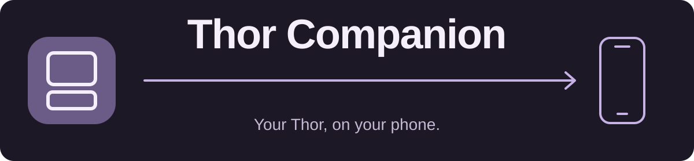
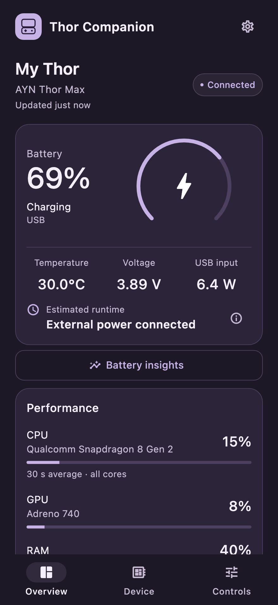
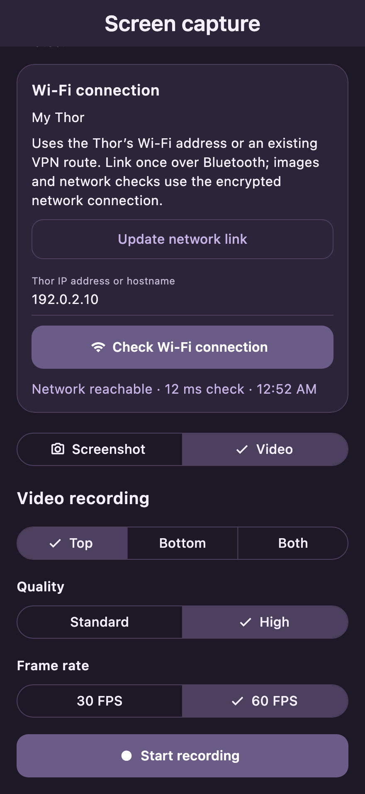
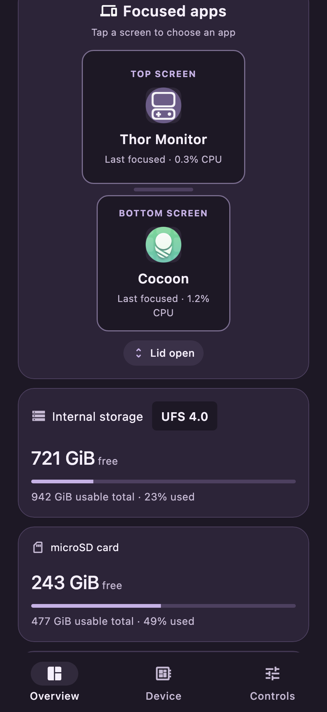
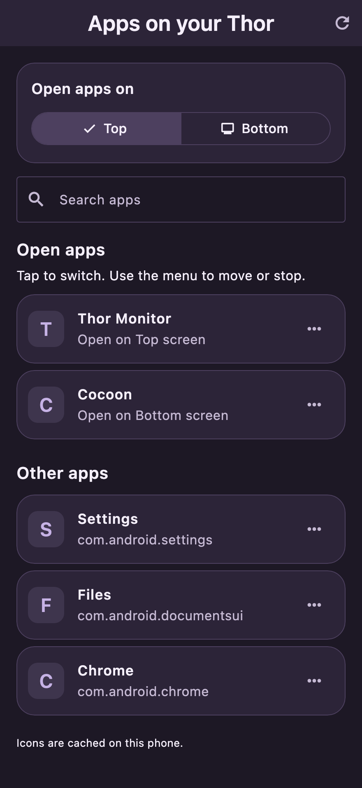
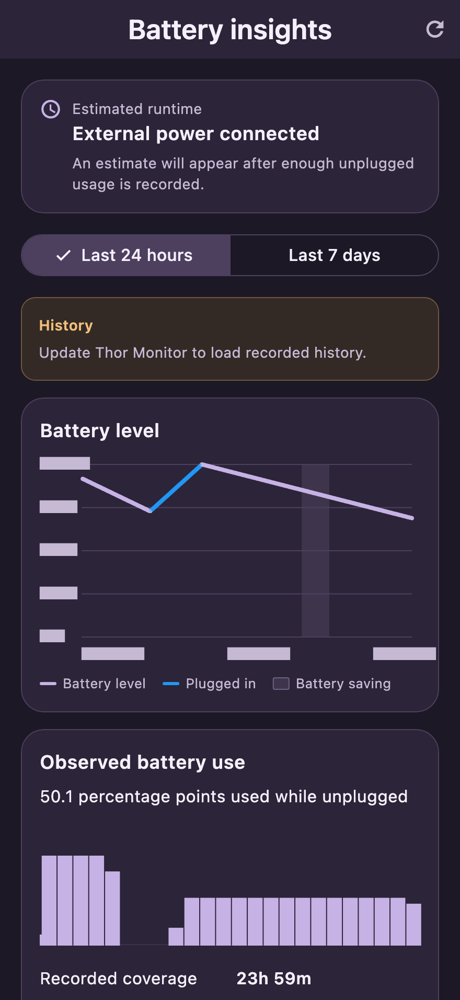
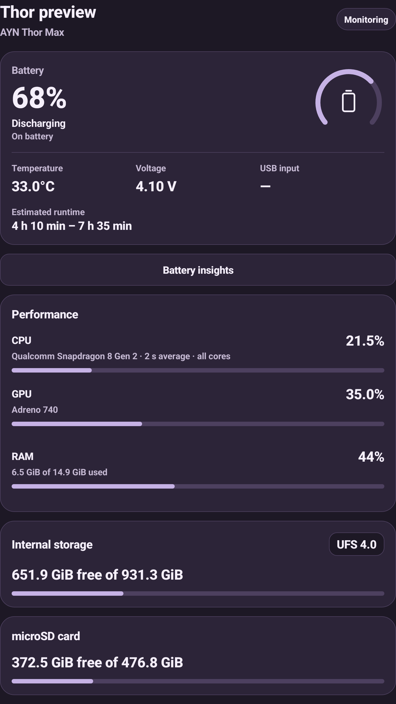

Monitor and control your AYN Thor from an iPhone or Android phone.

[Downloads](https://github.com/Allie9Lives/thor-companion/releases/latest) · [Setup](docs/setup.md) · [Report a bug](https://github.com/Allie9Lives/thor-companion/issues)

## Download 0.16.2

Install **Thor Monitor** on the Thor and **Thor Companion** on your phone. Update both apps.

| Device | Download |
| --- | --- |
| AYN Thor | [Thor Monitor APK](https://github.com/Allie9Lives/thor-companion/releases/download/v0.16.2/Thor-Monitor-0.16.2.apk) |
| Android phone | [Thor Companion APK](https://github.com/Allie9Lives/thor-companion/releases/download/v0.16.2/Thor-Companion-Android-0.16.2.apk) |
| iPhone | [Thor Companion IPA](https://github.com/Allie9Lives/thor-companion/releases/download/v0.16.2/Thor-Companion-iOS-0.16.2-development.ipa) |

The IPA is a development build and needs valid signing or re-signing to install. Source ZIPs and checksums are in the [release](https://github.com/Allie9Lives/thor-companion/releases/latest).

## New since 0.14.4

- **Screen recording:** top, bottom, or both, with game audio. Standard and High quality; 30/60 FPS export and stacked video on iPhone.
- **App drawer:** open, switch, move, or stop running apps. Tap either focused-screen box to choose an app.
- **FTP server:** start or stop encrypted FTP transfers from the app. Access internal storage and microSD over Wi-Fi or VPN.
- Updated battery layout, app icons, battery graph legend, and shorter settings text.

## Screenshots

Current interface with sample readings.

<table>
<tr><th>Overview</th><th>Screen recording</th></tr>
<tr><td></td><td></td></tr>
<tr><th>Focused apps</th><th>App drawer</th></tr>
<tr><td></td><td></td></tr>
<tr><th>Battery insights</th><th>Thor Monitor</th></tr>
<tr><td></td><td></td></tr>
</table>

## Features

- Battery, charging power, temperature, CPU/GPU/RAM, model, internal storage and microSD readings.
- Brightness and volume for both screens, sync controls, fan and performance modes, remote typing, and device power options.
- Battery history, runtime estimates, alerts, iPhone widgets and Live Activity.
- Find my Thor with a loud alarm, fade-out and on-screen Stop button.
- Bluetooth/Wi-Fi switching, automatic reconnect, pairing repair and overnight battery saving.
- Light, Dark, Clear Purple and Rainbow themes.

## Setup

1. Install Thor Monitor and follow its setup screens.
2. Open Thor Companion, find your Thor, and confirm Bluetooth pairing on both devices.
3. Finish **Controls recovery** on the Thor for advanced controls. Enable **Wi-Fi access** for recording and file transfers.

[Setup guide](docs/setup.md) · [Build instructions](BUILDING.md) · [Sound credits](docs/sound-credits.md)

## License

Free to use. Modification and redistribution require written permission; selling copies or charging for access is prohibited. See [LICENSE](LICENSE), including the third-party license terms.

© 2026 Allie Stark ([@Allie9Lives](https://github.com/Allie9Lives))
