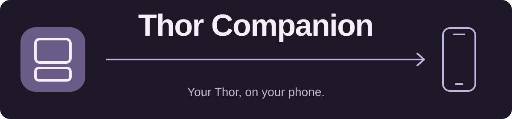
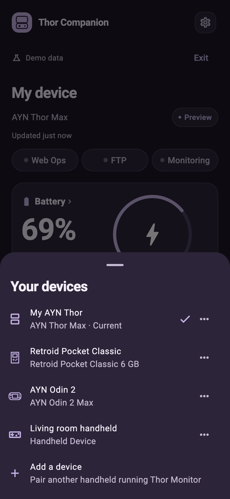
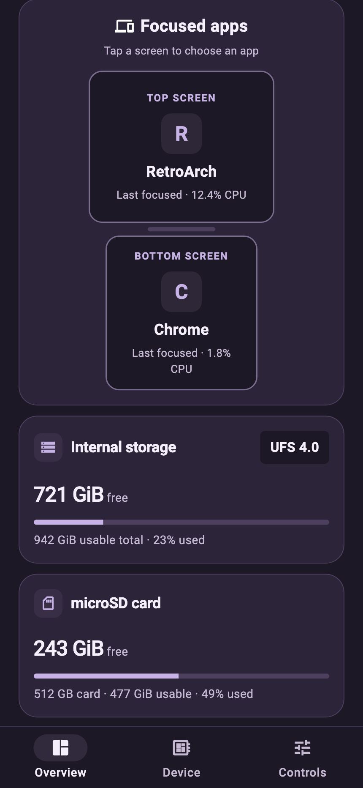
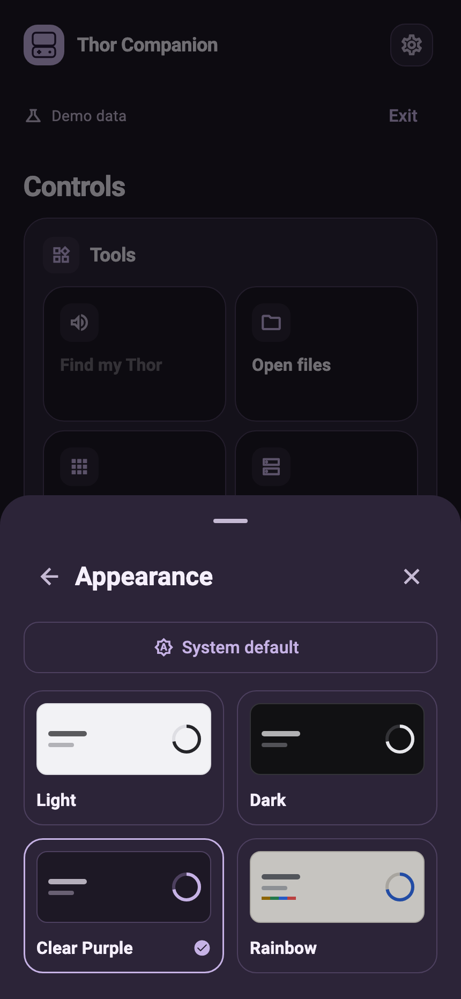
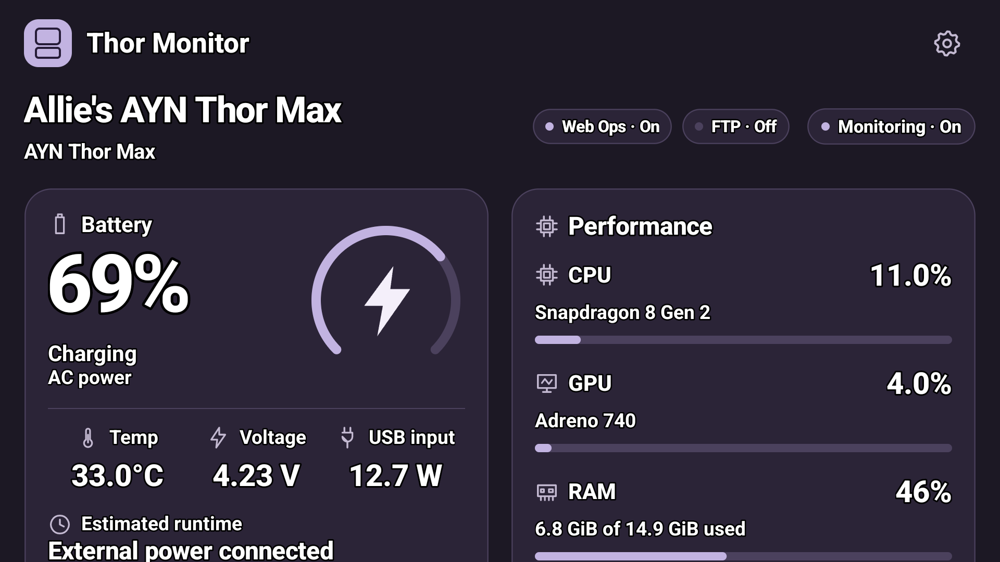
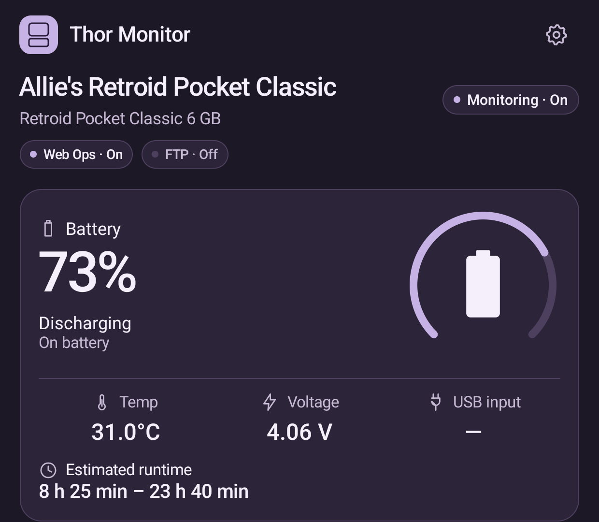

Monitor and control your Android handheld (AYN Thor, AYN Odin, Retroid Pocket Classic and others) from an iPhone or Android phone, or from a browser with Web Ops.

[Downloads](https://github.com/Allie9Lives/thor-companion/releases/latest) · [Setup](docs/setup.md) · [Report a bug](https://github.com/Allie9Lives/thor-companion/issues)

## Download 0.18.2

Install **Thor Monitor** on each handheld and **Thor Companion** on your phone. Update both apps to **0.18.2**.

| Device | Download |
| --- | --- |
| Handheld (AYN Thor, AYN Odin, Retroid Pocket Classic, other Android handhelds) | [Thor Monitor APK](https://github.com/Allie9Lives/thor-companion/releases/download/v0.18.2/Thor-Monitor-0.18.2.apk) |
| Android phone | [Thor Companion APK](https://github.com/Allie9Lives/thor-companion/releases/download/v0.18.2/Thor-Companion-Android-0.18.2.apk) |
| iPhone | [Thor Companion IPA](https://github.com/Allie9Lives/thor-companion/releases/download/v0.18.2/Thor-Companion-iOS-0.18.2-development.ipa) |

The IPA is a development build and needs valid signing or re-signing to install. Source ZIPs and checksums are in the [release](https://github.com/Allie9Lives/thor-companion/releases/latest).

## New in 0.18.2

- **Retroid Pocket Classic controls:** fan modes (Off, Quiet, Smart, Sport) and vibration on/off, alongside controller style.
- **Only real controls:** the Controls page hides anything the connected handheld doesn't have, instead of showing it as unavailable.
- **Vibration on more handhelds:** the system vibration switch works on any Android 13+ handheld with a vibrator.
- **Steadier reconnects:** a stale Bluetooth pairing no longer drops a working Wi-Fi/VPN connection while the app is in the background, so you don't come back to Bluetooth and readings errors. Re-pair the handheld to fix Bluetooth itself.
- **AYN Odin icon** in the device list.

## New in 0.18.1

- **Live view fix:** reopening live view (rotating, returning to the app) no longer fails with "Could not reach the device over the network".
- **AYN Odin:** Odin, Odin Lite, Odin 2, Odin 2 Mini, Odin 2 Portal and Odin 3 are recognized, including Base, Pro, Max and Ultra tiers. "Find my Odin" follows the device.
- **Retroid controller style:** switch between Xbox and standard button layouts on the Retroid Pocket Classic.
- **Alerts away from Bluetooth (Android phones):** while the app runs in the background, battery alerts also arrive over Wi-Fi or VPN.
- **Web Ops device links:** save each handheld's Web Ops address and jump between them from Settings or the sign-in page.

## New in 0.18.0 — CORE multi-device update

- **Multiple handhelds:** pair a Thor, a Retroid Pocket Classic and more. Tap the device name to switch, add or forget devices. Each keeps its own Bluetooth and Wi-Fi/VPN details.
- **Device detection:** AYN Thor and Retroid Pocket Classic (4 GB / 6 GB) are recognized, and any other Android handheld shows as *Handheld Device*. Controls a device doesn't have are hidden, and single-screen devices drop the top/bottom pickers.
- **Wi-Fi/VPN first:** the phone uses Wi-Fi or a VPN such as Tailscale whenever the device answers, with Bluetooth as the fallback. It can connect away from home with Bluetooth off.
- **Live view:** stream the top, bottom or both screens to your phone with a virtual controller, in portrait or landscape.
- **Longer recordings:** up to 10 minutes per clip.
- **Web Ops:** FTP credentials with copy buttons and a WinSCP/FileZilla download, an optional kept FTP password, and browser password saving at sign-in.
- **Storage details:** UFS and eMMC storage types, plus microSD shown by its card size.
- **Polish:** smoother menus and press glows, errors that float without moving the page and can be dismissed, and Bluetooth alerts that arrive on time.

## Since 0.16.6

- **0.17.0:** Web Ops in a browser, network switching with VPN support, Wi-Fi controls, connection notifications and connection fixes.

## Screenshots

Current interface with sample readings.

<table>
<tr><th>Overview</th><th>Your devices</th></tr>
<tr><td></td><td></td></tr>
<tr><th>Controls</th><th>Focused apps and storage</th></tr>
<tr><td></td><td></td></tr>
<tr><th>Settings</th><th>Themes</th></tr>
<tr><td></td><td></td></tr>
<tr><th>Thor Monitor on an AYN Thor</th><th>Thor Monitor on a Retroid Pocket Classic</th></tr>
<tr><td></td><td></td></tr>
</table>

Phone screenshots are rendered from the app's demo data by `test/readme_screens_test.dart`.

## Features

- Battery, charging power, temperature, CPU/GPU/RAM, model, internal storage and microSD readings.
- Brightness and volume (per screen on the Thor), fan and performance modes on AYN devices, controller layout on AYN and Retroid, fan modes on the Retroid Pocket Classic, remote typing, and device power options.
- Live view with a virtual controller, screenshots and recordings of up to 10 minutes.
- Battery history, runtime estimates, alerts, iPhone widgets and Live Activity.
- Find my device with a loud alarm, fade-out and on-screen Stop button.
- Wi-Fi/VPN first with Bluetooth fallback, multiple saved devices, automatic reconnect, pairing repair and overnight battery saving.
- Light, Dark, Clear Purple and Rainbow themes.

## Setup

1. Install Thor Monitor on the handheld and follow its setup screens.
2. Open Thor Companion, find your device, and confirm Bluetooth pairing on both devices. To add another handheld later, tap the device name and choose **Add a device**.
3. Finish **Controls recovery** on the handheld for advanced controls. Enable **Wi-Fi access** for live view, recording, Web Ops and file transfers.

[Setup guide](docs/setup.md) · [Build instructions](BUILDING.md) · [Sound credits](docs/sound-credits.md)

## License

Free to use. Modification and redistribution require written permission; selling copies or charging for access is prohibited. See [LICENSE](LICENSE), including the third-party license terms.

© 2026 Allie Stark ([@Allie9Lives](https://github.com/Allie9Lives))
