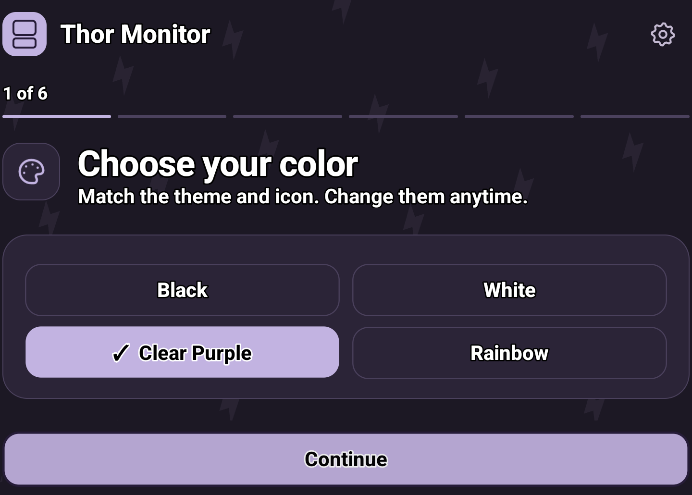
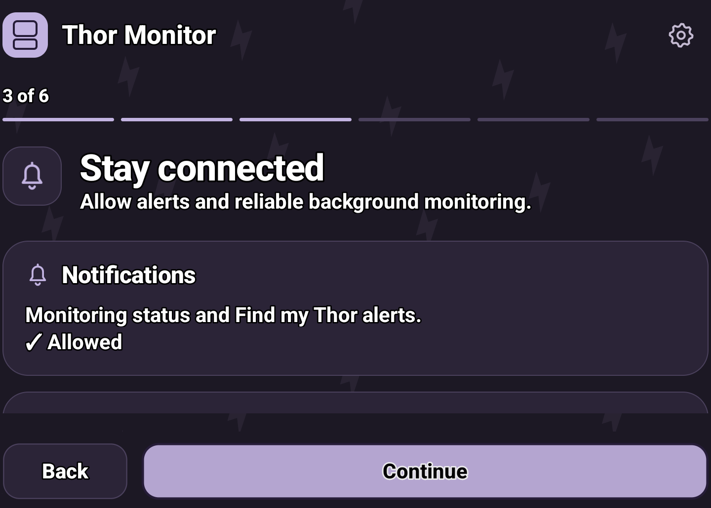
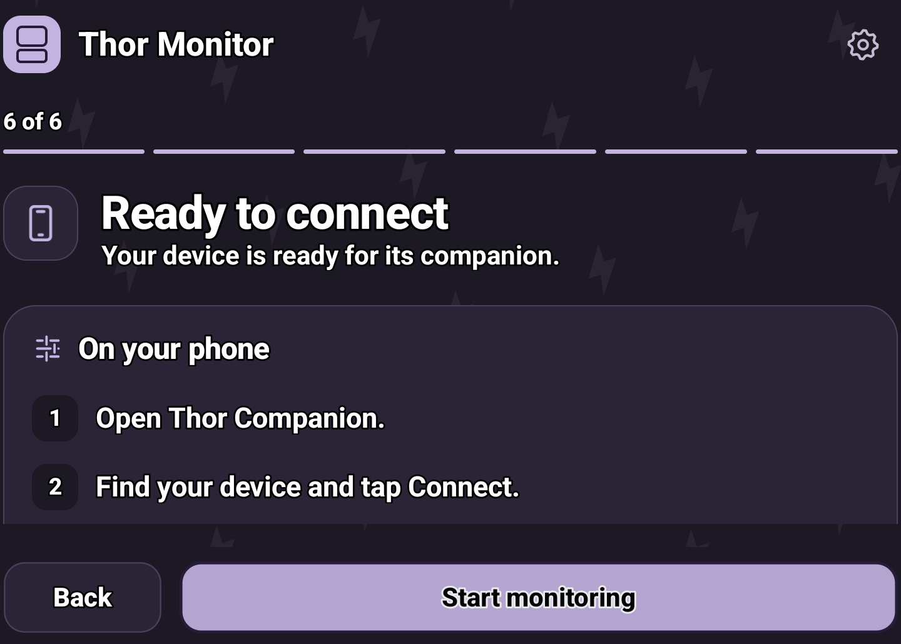
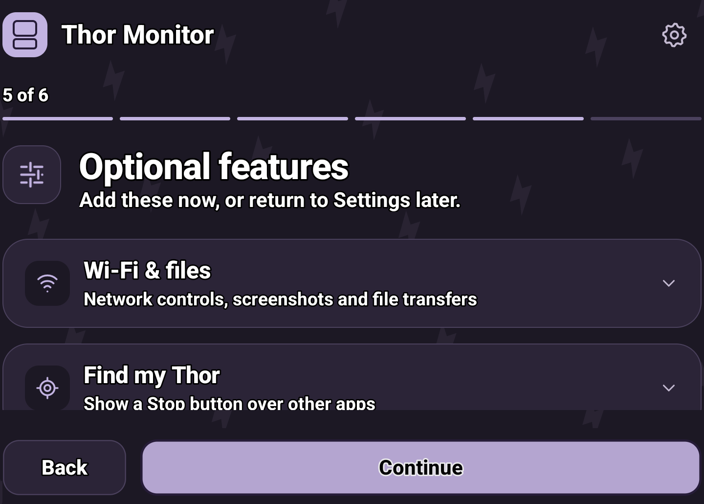

# Setup guide

Install **Thor Monitor** on each handheld (AYN Thor, Retroid Pocket Classic or another Android handheld) and **Thor Companion** on your phone.

## 1. Set up your handheld

Open Thor Monitor and follow the setup screens.

### Choose your color

Pick a theme and icon. You can change these later in Appearance.

### Allow Bluetooth and background monitoring

Allow **Nearby devices**, **notifications**, and **unrestricted battery use**. Enable **Start after restart** if you want monitoring to resume automatically.

Continue through advanced controls and optional features, then **start monitoring**.

## 2. Connect your phone

1. Keep the handheld open and unlocked.
2. Open Thor Companion and allow Bluetooth access.
3. Find your device, tap **Connect**, and confirm pairing on both devices.

The app remembers the device and reconnects automatically. **Disconnect** pauses this until you tap **Reconnect**.

### Add more handhelds

Tap the device name at the top of the dashboard to open **Your devices**. Choose **Add a device**, keep Thor Monitor open on the new handheld, and pair it. Tap any saved device to switch to it; one is connected at a time. Each device keeps its own Bluetooth pairing and Wi-Fi/VPN details. **⋯ → Forget device** removes one.

The app adapts to each device: single-screen handhelds hide the top/bottom choices, and controls a device doesn't have are hidden.

## 3. Enable advanced controls

For power controls, screen capture and (on AYN devices) fan and performance modes, pair Thor Monitor with Android’s wireless debugging service. You only need the handheld for this.

1. Connect to trusted Wi-Fi. In Android Settings, tap **Build number** seven times to enable Developer options if needed.
2. In Thor Monitor, open **gear → Controls recovery → Recovery setup → Open wireless debugging**. Enable it and approve the network prompt.
3. In Android's Wireless debugging page, choose **Pair device with pairing code**. Keep that window open.
4. Enter its **pairing port** and six-digit code in Thor Monitor, then tap **Pair**. Use the port shown beside the code, not the ordinary connection port.
5. Enable automatic controls recovery and wait for **Advanced controls ready**.

After restarting, unlock the handheld once. Controls reconnect when Wi-Fi and wireless debugging are available. Android may ask you to approve a new network.

## 4. Use it away from home (optional)

Thor Companion uses Wi-Fi or a VPN whenever the device answers, and falls back to Bluetooth.

1. Turn on **Wi-Fi access** in Thor Monitor and connect once over Bluetooth at home so the phone learns the device's addresses.
2. Install a VPN such as **Tailscale** on both the handheld and the phone, and sign in to the same account. Keep it running on the handheld while you're home once, so the phone learns its VPN address. You can also enter the address under **gear → Connection health**.
3. Away from home, open Thor Companion with the VPN on. It connects without Bluetooth.

Bluetooth is still used for first pairing, changing the handheld's Wi-Fi, and background alerts.

## Optional features

Choose these during setup, or return to them in the host settings later.

| Feature | Setup |
| --- | --- |
| Wi-Fi controls, files and screen capture | Turn on **Wi-Fi access** on the handheld and allow **Local Network** on iPhone. Follow the Bluetooth linking prompt, then choose which folders to share. Existing VPN settings are unchanged. |
| Live view | Open **Controls → Live view**. Choose Top, Bottom or Both on a Thor, rotate for landscape, and turn on the virtual controller to play. |
| Screen recording | Open **Controls → Screen capture → Video** on the phone. Record clips of up to 10 minutes, then **Stop & save**. iPhone also offers 30/60 FPS export. |
| Web Ops | Turn on **Web Ops** in Thor Monitor and set an owner login. Open the address it shows in a browser on the same Wi-Fi or VPN. Use **Trust this device** once per computer so the browser can save your password. |
| FTP server | Start it from **Controls → FTP server** on the phone or **Files → Desktop file transfer** in Web Ops. Web Ops has copy buttons for each detail and **Download for WinSCP / FileZilla** (WinSCP: **Tools → Import Sites → FileZilla**). Use **explicit TLS** and passive mode. Turn on **Keep the same password** if you don't want a new password each time. |
| App drawer | Tap a focused-screen box or **Open apps** in Controls. Open apps can be switched, moved or stopped. |
| Phone keyboard | Open **Phone keyboard** in the host settings and follow the prompts. |
| Find my device | Allow **Stop panel over apps** on the handheld to dismiss the sound over any app. |
| Battery alerts | Open **gear → Notifications** on your phone, choose your alerts and send a test. Keep the app running in the background to receive them. |
| Battery widgets | Add the battery widget to your Home or Lock Screen. Turn on **Live battery** in the app for more frequent updates. |
| Battery history | Tap **Battery insights** below the battery card. The graph fills in as you use the app. |

## Overnight battery saving

On the handheld, open **gear → Monitoring → Battery saving** and add your trusted Wi-Fi.

By default, on trusted Wi-Fi, the handheld can sleep after **3 hours with screens off** between **9 PM and 6 AM**. You can change those times or turn on **Keep awake while plugged in**. Allow **Alarms & reminders** so monitoring can resume at the scheduled time without waking the screens.

## Need help?

- **No readings:** Open Thor Monitor, start monitoring, then reconnect from the phone.
- **Device not found when adding it:** Keep Thor Monitor open on the handheld with Bluetooth on, and make sure monitoring is running.
- **Pairing needs repair:** Tap **Fix** on the warning, or dismiss it with **✕** and use **gear → Connection health** later.
- **Controls unavailable:** Open Recovery setup and retry; check for a wireless-debugging approval prompt.
- **Screenshots, live view or files won't connect:** Check Wi-Fi access and network reachability (or your VPN). Screen capture also needs advanced controls and an open, unlocked handheld.
- **Review permissions:** Use **gear → Review setup** on the handheld.

[Back to downloads](../README.md) · [Sound credits](sound-credits.md)
