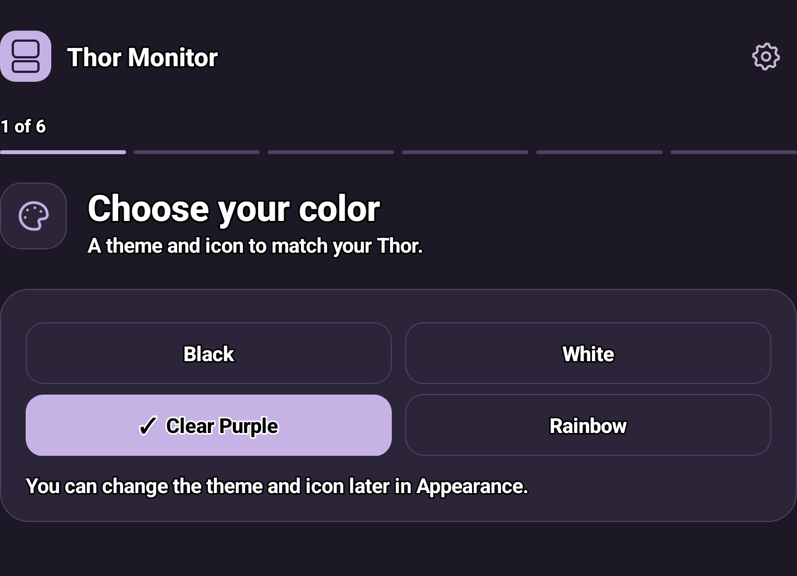
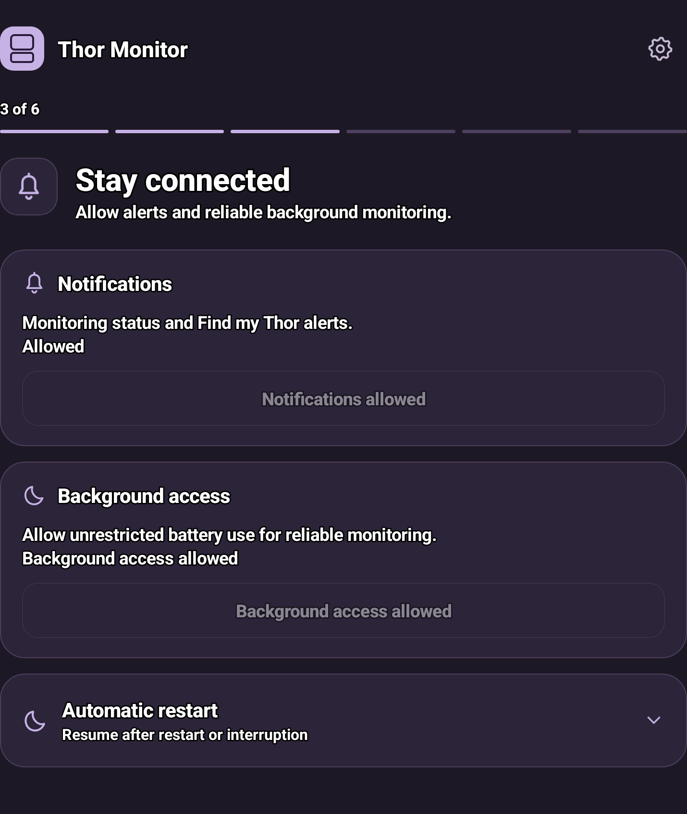
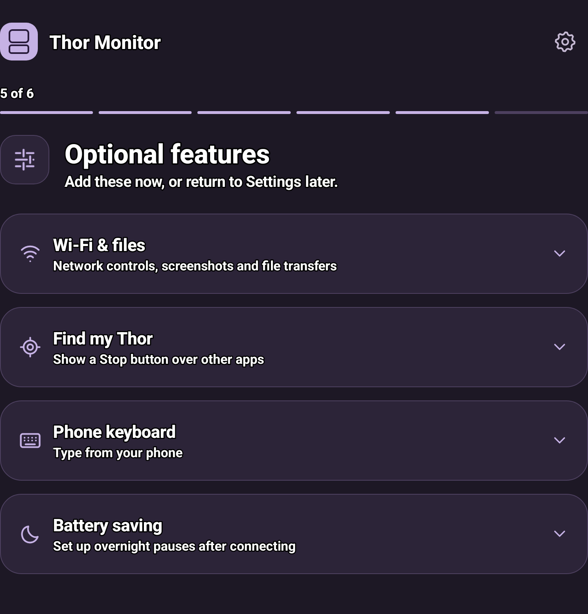
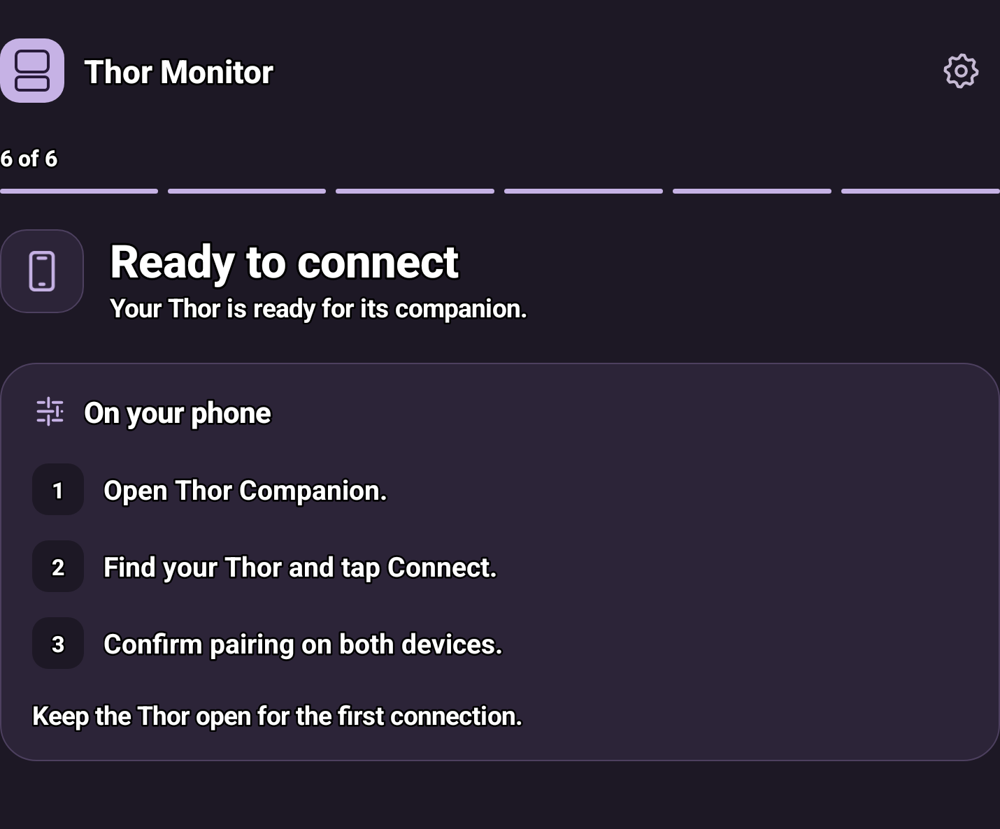

# Setup guide

Install **Thor Monitor** on your Thor and **Thor Companion** on your phone.

## 1. Set up your Thor

Open Thor Monitor and follow the six setup steps:

- Choose a color. You can change it later in Appearance.
- Allow **Nearby devices**, **notifications**, and **unrestricted battery use**.
- Enable **Start after restart** if you want monitoring to resume automatically.
- Set up advanced controls below, or skip them for now.
- Choose any optional features, then **start monitoring**.

<table>
<tr><th>Choose your color</th><th>Allow background monitoring</th></tr>
<tr><td></td><td></td></tr>
<tr><th>Choose optional features</th><th>Connect your phone</th></tr>
<tr><td></td><td></td></tr>
</table>

*Example onboarding screens. Your permission status may differ.*

## 2. Connect your phone

1. Keep the Thor open and unlocked.
2. Open Thor Companion and allow Bluetooth access.
3. Find your Thor, tap **Connect**, and confirm pairing on both devices.

The app remembers your Thor and reconnects automatically. **Disconnect** pauses this until you tap **Reconnect**.

## 3. Enable advanced controls

Required for fan, performance, power and other advanced controls. Complete this on the Thor; no computer is needed.

1. Connect to trusted Wi-Fi. In Android Settings, tap **Build number** seven times to enable Developer options if needed.
2. In Thor Monitor, open **gear → Controls recovery → Recovery setup → Open wireless debugging**. Enable it and approve the network prompt.
3. In Android's Wireless debugging page, choose **Pair device with pairing code**. Keep that window open.
4. Enter its **pairing port** and six-digit code in Thor Monitor, then tap **Pair**. Use the port shown beside the code, not the ordinary connection port.
5. Enable automatic controls recovery and wait for **Advanced controls ready**.

After a restart, unlock the Thor once. Recovery resumes when trusted Wi-Fi and wireless debugging are available. A different network may require approval again.

## Optional features

| Feature | Setup |
| --- | --- |
| Wi-Fi controls, files and screenshots | Enable **Wi-Fi access** on the Thor. Allow **Local Network** on iPhone. Link access over Bluetooth when prompted. For files, select folders or allow full shared-storage access on the Thor. Existing Tailscale settings stay unchanged. |
| Phone keyboard | Follow **Phone keyboard** setup on the Thor. |
| Find my Thor | Allow **Stop panel over apps** on the Thor to dismiss the sound over any app. |
| Battery alerts | On your phone, open **gear → Battery notifications**, enable your alerts and send a test. Alerts need incoming readings; they won't arrive after force-quitting the iPhone app. |
| Battery widgets | Add **Thor Battery** from your iPhone's Home or Lock Screen widget picker. For more frequent updates, enable **Live battery** in the app. |
| Battery history | Open **Battery insights** below the battery card. History builds as monitoring runs. |

## Overnight battery saving

On the Thor, open **gear → Monitoring → Battery saving** and add your trusted Wi-Fi.

The default pauses CPU keep-alive after **3 hours with screens off**, between **9 PM and 6 AM**. Change the delay or restore time there, and optionally enable **Keep awake while plugged in**. Allow **Alarms & reminders** for an on-time morning restore with the screens left off.

## Need help?

- **No readings:** Open Thor Monitor, start monitoring, then reconnect from the phone.
- **Controls unavailable:** Open Recovery setup and retry; check for a wireless-debugging approval prompt.
- **Screenshots or files won't connect:** Check Wi-Fi access and network reachability. Screenshots also need advanced controls and an open, unlocked Thor.
- **Review permissions:** Use **gear → Review setup** on the Thor.

[Back to downloads](../README.md) · [Sound credits](sound-credits.md)
